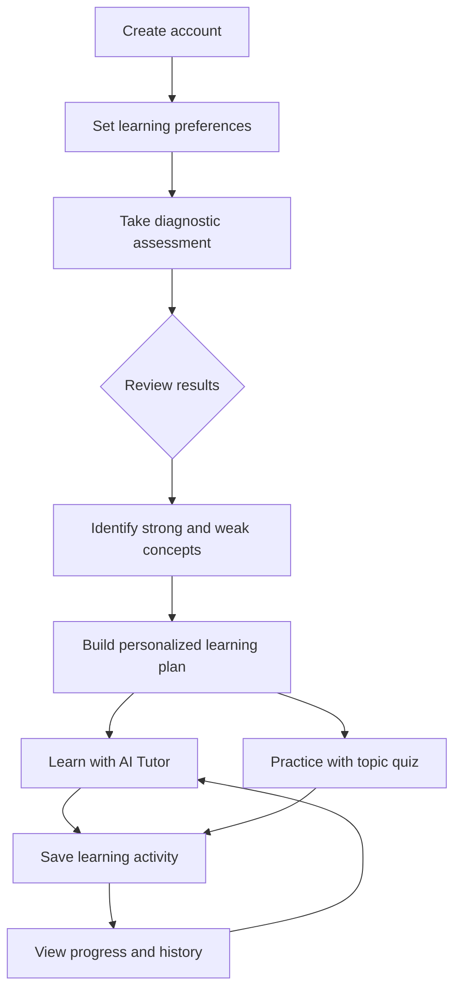

# StudyBuddy

> **Learn smarter, one concept at a time.**
>
> StudyBuddy is a personalized learning companion that helps students find knowledge gaps, get a focused study plan, practice at the right level, and track their progress.

[](https://www.python.org/)
[](https://streamlit.io/)
[](https://www.mongodb.com/)
[](./LICENSE)

## The idea

Students often know *what* they need to study, but not *where to start*. StudyBuddy turns a learner's goals, preferences, and assessment results into a practical next step—then helps them learn, practice, and see how they are progressing.

## What you can do

- **Set up a learning profile** with a subject, goal, level, explanation style, and daily target.
- **Take a diagnostic assessment** to identify strong concepts and topics to revisit.
- **Get a focused learning plan** based on assessment results, with revision and extension topics.
- **Learn with an AI tutor** that uses the learner's level, preferred style, and previous mistakes as context.
- **Practice with topic-focused quizzes** and review accuracy and concepts to revisit.
- **Track learning over time** through results, topic mastery, and learning history.
- **Manage an account** with sign-in, persistent sessions, and password reset by email.

## How it works



## Built with

| Area | Technology |
| --- | --- |
| App and interface | Python, Streamlit |
| Data storage | MongoDB with PyMongo |
| AI tutor and generated questions | Google Gemini API (optional) |
| Progress visualizations | Plotly, pandas |
| Authentication | bcrypt, Streamlit cookies |
| Password reset email | Resend API (optional) |

## Get started

### Requirements

- Python 3.11 (also pinned for Render deployments)
- A MongoDB connection string (for example, a MongoDB Atlas cluster)
- A Gemini API key for live AI responses (optional; demo mode is available without one)

### 1. Clone and enter the project

```bash
git clone https://github.com/JiyaBatra/StudyBuddy.git
cd StudyBuddy
```

### 2. Create a virtual environment and install dependencies

**Windows (PowerShell):**

```powershell
py -3.11 -m venv .venv
.\.venv\Scripts\Activate.ps1
python -m pip install -r requirements.txt
```

**macOS / Linux:**

```bash
python3.11 -m venv .venv
source .venv/bin/activate
python -m pip install -r requirements.txt
```

### 3. Configure environment variables

Copy `.env.example` to `.env`, then set at least your MongoDB connection:

```dotenv
MONGODB_URI=mongodb+srv://<username>:<password>@<cluster>/?retryWrites=true&w=majority
DATABASE_NAME=learnwise_ai
```

To enable live Gemini responses and generated questions, also set:

```dotenv
LLM_PROVIDER=gemini
GEMINI_API_KEY=<your-gemini-api-key>
GEMINI_MODEL=gemini-3.5-flash-lite
```

Password-reset email is optional. To enable it, configure a Resend API key, a verified sender, and the URL where the app is reachable:

```dotenv
RESEND_API_KEY=<your-resend-api-key>
RESEND_FROM_EMAIL=StudyBuddy <noreply@example.com>
APP_BASE_URL=http://localhost:8501
```

Never commit `.env` or paste API keys into source code. For MongoDB Atlas, make sure your cluster is running and your current IP address is allowed in **Network Access**.

### 4. Run StudyBuddy

```bash
streamlit run app.py
```

Open the local URL printed by Streamlit, create an account, and complete the student setup to begin.

## AI and demo mode

StudyBuddy requires MongoDB for accounts and saved learning data. If `GEMINI_API_KEY` is not configured, the app uses a clearly labelled demo tutor response and built-in diagnostic questions where available. Add a valid Gemini key to enable live tutor responses and AI-generated assessment and quiz questions.

## Project structure

```text
StudyBuddy/
├── app.py                    # App entry point, sign-in, sign-up, onboarding
├── pages/                    # Dashboard, tutor, assessments, plan, quizzes, progress
├── core/                     # Tutor, assessment, learning-plan, and mastery logic
├── auth/                     # Authentication, sessions, password management
├── database/                 # MongoDB connection and persistence operations
├── utils/                    # Shared layout, styling, constants, and validation
├── tests/                    # Authentication and password-reset tests
├── assets/                   # App media assets
├── .env.example              # Environment variable template
└── requirements.txt          # Python dependencies
```

## Run tests

```bash
python -m unittest discover -s tests
```

## License

This project is licensed under the [MIT License](./LICENSE).

## Hackathon demo path

1. Sign up and set a learning goal and preferred explanation style.
2. Take a diagnostic assessment for a subject and topic.
3. Show the generated plan and its strong / revision topics.
4. Open a topic in the AI Tutor, then try a topic quiz.
5. Finish on Results or Progress to show the learning history.

---

Made for learners who want a clearer next step.
